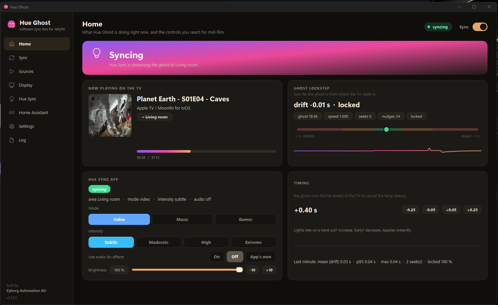
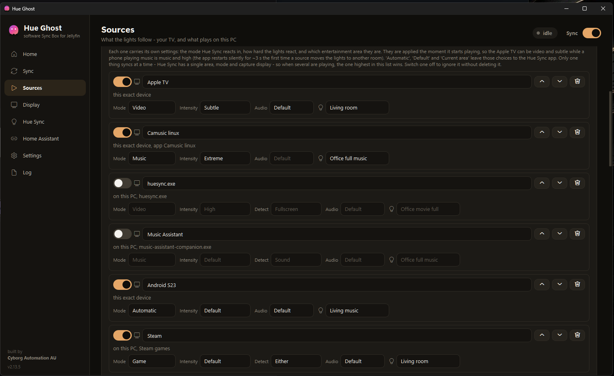
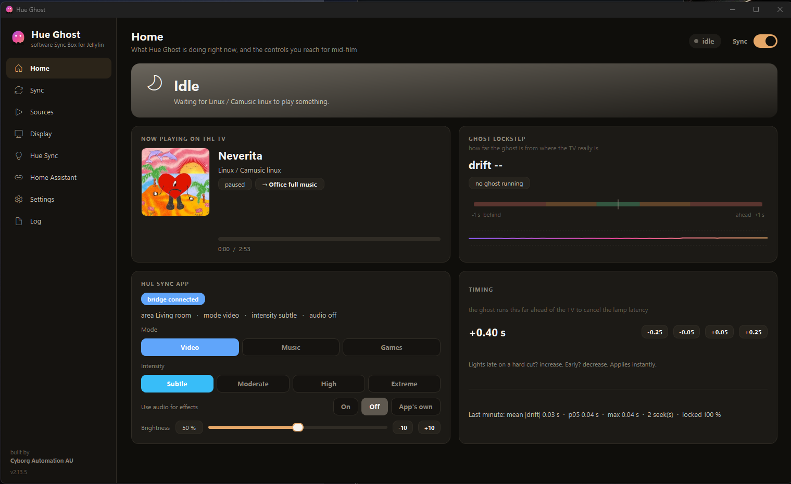
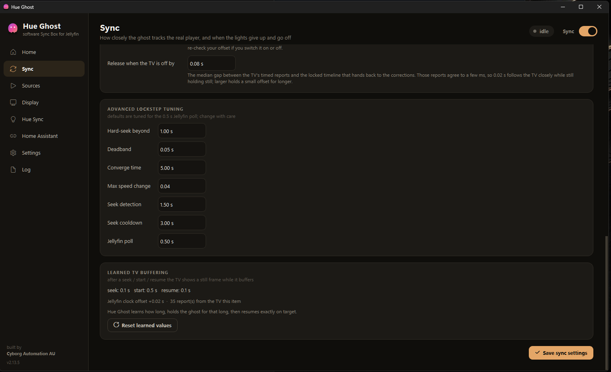
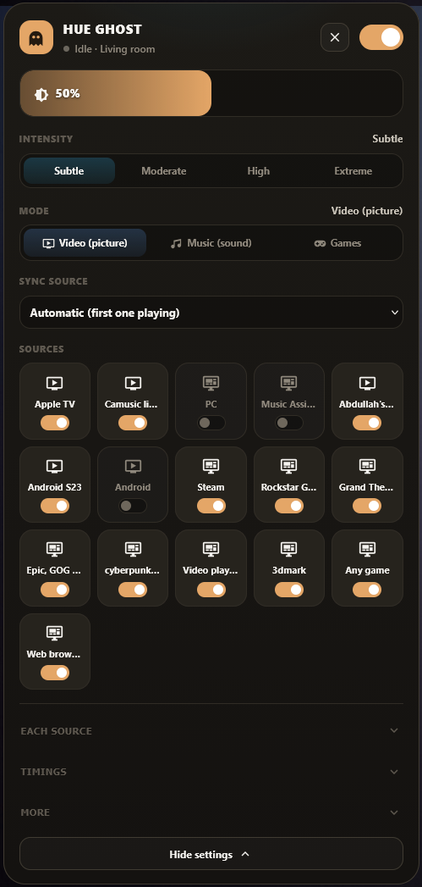
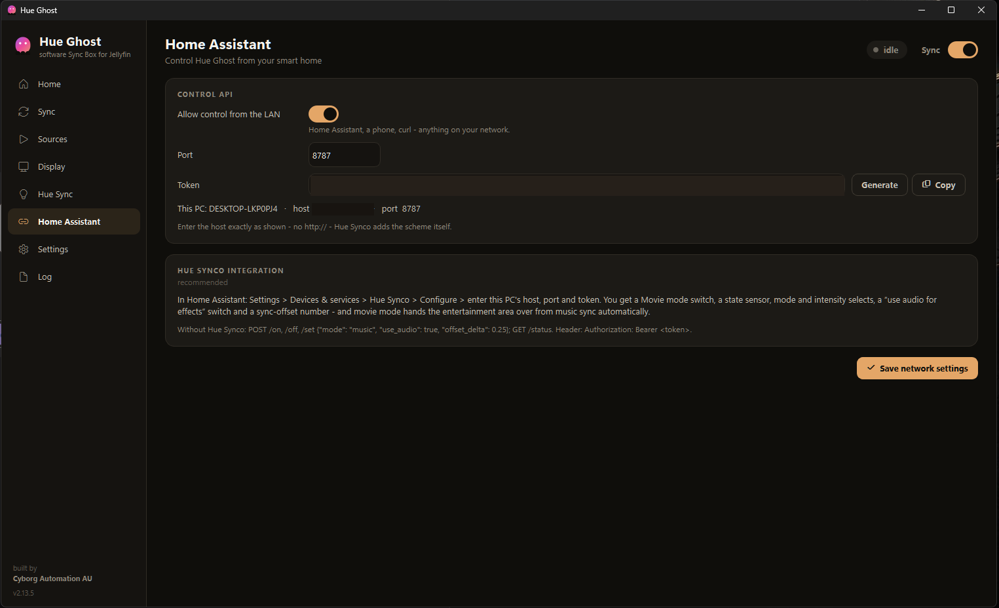
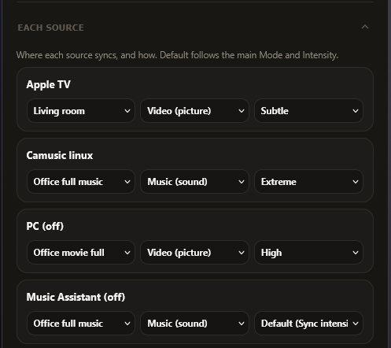
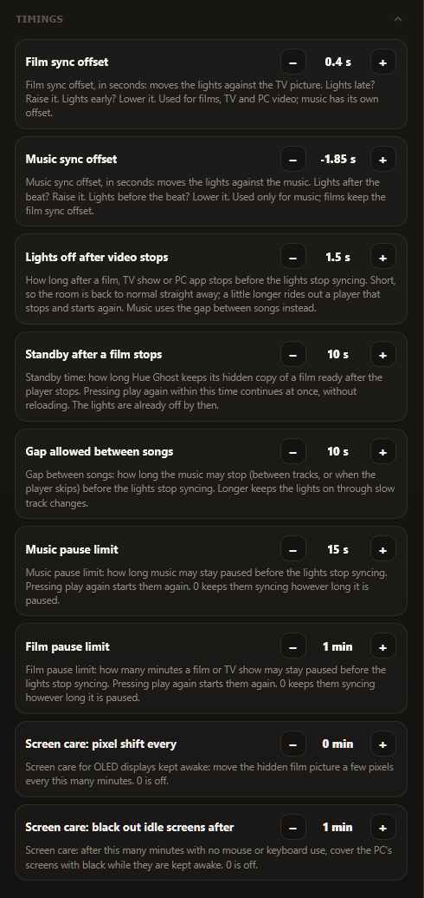
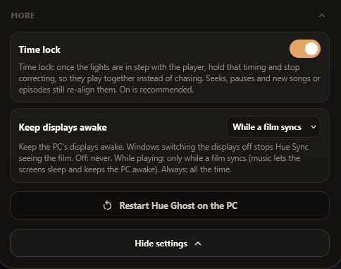

# Hue Ghost

[](https://github.com/engabd11/HueGhost/releases/latest)
[](https://github.com/engabd11/HueGhost/releases)

**Philips Hue light sync for Jellyfin, PC apps and games.**

Press play on any Jellyfin client (Apple TV, Android TV, a phone and more), or start a game or video on your PC, and the Hue lights in the room follow the picture. Hue Ghost does it with the free Hue Sync desktop app, and your TV keeps playing its own stream, so 4K, HDR and Dolby Vision work as usual.

Free and open source (MIT), built by [Cyborg Automation AU](https://cyborgautomation.com.au/pages/hue-ghost). [Download the latest release](https://github.com/engabd11/HueGhost/releases/latest).

```
TV plays the film (any Jellyfin client)
  → Jellyfin server reports what is playing
  → Hue Ghost on your PC plays a silent copy in step with the TV: the ghost
  → Hue Sync app watches the ghost
  → Hue Bridge → your lights
```



*Home while a show plays on an Apple TV: the ghost is 0.01 s from the TV and locked, and Hue Sync is streaming to the Living room.*

## What it does

The free Philips **Hue Sync** desktop app turns whatever is on a PC screen into light. Hue Ghost extends that to the picture on your TV, and automates the rest:

1. **Films and shows on your TV (Jellyfin).** Hue Ghost plays a silent, hidden copy of the same film on the PC, the **ghost**, and keeps it on the same frame as the TV. Hue Sync watches the ghost, so the lights match the TV.
2. **Apps and games on your PC.** The picture is already on a screen Hue Sync can see, so Hue Ghost switches the sync on when something starts playing, in the right room and mode.
3. **Music.** Hue Ghost plays the track to an audio output you set aside, and Hue Sync's music mode listens to that.

You set it up once. After that you press play, and the lights stop when playback stops.

### Example setups

| You want | Add this source | Mode / intensity / room |
|---|---|---|
| The Apple TV in the lounge room to light the lounge | *Jellyfin*, your Apple TV | Video, Subtle, *Living room* |
| Your phone's music app to light the same room with the music | *Jellyfin*, the phone (the entry shows the app, so pick the music one) | Music, High, *Living room* (needs a [spare audio output](#settings-explained)) |
| Every game on the PC to light the office | *Quick add > Any game* | Games, Extreme, *Office* |
| YouTube and Netflix in the browser to light the office | *Quick add > Web browsers* | Video, Moderate, *Office* |
| One game to flash with explosions and nothing else | Type the game's `.exe` | Games, Audio **On** |
| A film in VLC to light the room | *Quick add > Video players* | Video, Subtle |
| One button on the wall to start all of it | Hue Synco's **Global sync** light in Home Assistant ([below](#home-assistant)) | - |

Put them all in one list. If two play at once, the one nearest the top wins.

## What you need

| | |
|---|---|
| **PC** | Windows 10 or 11 (64-bit), left on while you watch, with sleep switched off |
| **Lights** | A Hue Bridge (v2) with an **entertainment area** set up in the Hue app |
| **Hue Sync** | The free [Hue Sync desktop app](https://www.philips-hue.com/en-us/explore-hue/propositions/entertainment/sync-with-pc), paired with your bridge |
| **Jellyfin** *(for TV sync)* | A Jellyfin server (10.9 or newer) on your network, and a Jellyfin API key |
| **Ghost display** *(for TV sync)* | A spare display for the ghost: the installer adds a **virtual display**, or use an HDMI dummy plug |
| **Spare audio output** *(for Jellyfin music, optional)* | A spare audio output reserved for the ghost, such as an unused optical port or a virtual output (virtual audio cable, Steam Streaming Speakers); not a monitor's own audio, which goes away when the screen sleeps |

Syncing apps and games on the PC only? You need just the PC, the bridge and Hue Sync.

The ghost plays the original file, so the graphics card should decode your films (4K HEVC or AV1 needs a reasonably recent GPU).

## Install

1. Download **`HueGhost-Setup-<version>.exe`** from [Releases](https://github.com/engabd11/HueGhost/releases) and run it. It installs the app, the **mpv** player that plays the ghost, and (optional, recommended) the **virtual display**. It can also start Hue Ghost when you sign in.
2. Install **Hue Sync** if it is new to you, pair it with your bridge and pick the entertainment area of the room.

## Set up (about 5 minutes)

Open **Hue Ghost** from the Start menu. The first run opens on **Sources**.

1. **Sources**: add what the lights should follow.
   - *A TV or phone:* enter your Jellyfin URL and API key (Jellyfin Dashboard > API Keys > +), click *Test and list players*, play something on the TV, select it and click *Add selected player*.
   - *An app or game on this PC:* use **Quick add** (for example *Any game* or *Web browsers*), pick it from the list of running apps, or type its `.exe`.
   - Give each one its **mode** (Video, Music or Games), **intensity** and **room** (entertainment area), then **Save sources**.
2. **Display**: pick the ghost display (the virtual display) and click *Show test pattern for 8 s* to check it is the right one. (TV sync only.)
3. **Hue Sync**: in the Hue Sync app, once, switch *Settings > Allow public control* **on** and *Start syncing when Hue Sync launches* **off**. The page checks this for you.
4. **Home**: press play on the TV and watch the state go from *idle* to *ghost playing* to *syncing*.

Closing the window leaves Hue Ghost running in the tray. The tray icon shows the state: grey idle, blue ghost playing, green syncing, red when Jellyfin cannot be reached.

## What you can sync

| Source | How to add it | What Hue Sync watches |
|---|---|---|
| Jellyfin on a TV, Apple TV, Android TV or phone | *Sources > Jellyfin* | the ghost |
| Jellyfin music | same, plus a spare output (*Display > Ghost audio output*) | the ghost (sound only) |
| A browser (YouTube, Netflix, Disney+ and more) | *Quick add > Web browsers* | your screen |
| VLC, MPC-HC, PotPlayer, Kodi, Plex, Jellyfin Media Player | *Quick add > Video players* | your screen |
| Spotify | *Quick add > Spotify* | your screen |
| **Any PC game** (Steam, Epic, GOG, Xbox, EA, Ubisoft, Riot) | *Quick add > Any game* | your screen |
| **Games streamed with Sunshine to Moonlight** | *Quick add > Any game* on the Sunshine PC | your screen |
| Games streamed *to* this PC (Moonlight, GeForce NOW, Parsec, Steam Link) | *Quick add > Games streamed to this PC* | your screen |
| One specific app or game | pick it from the running apps, or type its `.exe` | your screen |
| Anything that fills the screen | *Quick add > Any app on this PC* | your screen |

- **One source at a time.** If several are playing, the one **highest in the list** wins, so drag rows to reorder. Each row has an on/off switch.
- **Each source brings its own look.** When a source starts, Hue Sync switches to its mode, intensity and room, so the Apple TV can be *Video / Subtle* in the lounge room and a game *Games / Extreme* in the office.



### What each row on the Sources page does

| Field | What it does |
|---|---|
| **On/off switch** | Ignore the source for now without deleting it. |
| **Name** | Edit it to whatever you like (*S23 music*). Phones all arrive from Jellyfin as plain "Android", so naming them helps. |
| **Up / down arrows** | Priority. The playing source nearest the top gets the lights. |
| **Bin** | Removes the source. |
| **Line under the name** | What the row matches: *this exact device* for a Jellyfin player, or *on this PC* and the app's `.exe`. |
| **Mode** | *Video* reacts to the picture, *Music* to the sound, *Game* to a game. *Automatic* (Jellyfin clients only) uses music mode for a song and video for anything else. |
| **Intensity** | How strongly the lights react: Subtle, Moderate, High or Extreme. *Default* uses the one on Home. |
| **Detect** *(PC apps only)* | How Hue Ghost knows the app is playing: *Sound* (it is making some), *Fullscreen* (it fills the screen) or *Either*. Video defaults to sound, games to fullscreen. |
| **Audio** | Hue Sync's *use audio for light effects* while this source plays. *On* for a game so explosions flash, *Off* for a film. *Default* uses the setting on Home. |
| **Room** (light bulb) | The entertainment area to sync. *Current area* leaves Hue Sync on whatever it is set to. |

Leave a field on *Automatic*, *Default* or *Current area* and Hue Ghost does not touch that setting at all. Phones, music, several rooms, several apps in one source and how *Any game* decides are in [docs/sources.md](docs/sources.md).

## Features at a glance

- **Automatic on and off.** Lights start when playback starts and stop about 1.5 s after it stops. Pauses and next episodes are handled for you.
- **Frame-accurate TV sync.** The ghost follows the TV to within about 0.1 to 0.2 s, and follows seeks within about a second.
- **Time lock** (on by default). Once the ghost matches the TV, Hue Ghost holds it steady instead of correcting on every report, which makes the lights noticeably smoother. It lets go on a seek, pause or buffering, and locks again straight after.
- **Offset tuning from the couch.** If the lights change *late* on a hard cut, press **+0.25** on Home. If *early*, press **-0.25**. See [Tuning the timing](#tuning-the-timing).
- **Several rooms.** Each source can light its own entertainment area.
- **Displays kept awake.** Hue Ghost holds the displays awake while something plays, so Hue Sync always has a picture to watch.
- **OLED care.** The ghost picture shifts a few pixels now and then, and other screens can go black while you are away from the PC.
- **Home Assistant.** Control it from [Hue Synco](https://github.com/engabd11/syncoV2) or plain REST ([docs/home-assistant.md](docs/home-assistant.md)).
- **Tray icon and command line** (`hue-ghost status`, `on`, `off`, `set`, `doctor` and more).

## Settings explained

Every setting is in the app and saved in `%APPDATA%\hue-ghost\config.json`. The deep dive is [docs/settings.md](docs/settings.md); this is what each one is for.

### Home (what is happening now, and controls for mid-film)



*Home while idle. The screenshot at the top of this page is the same page while syncing.*

| On the page | What it shows or does |
|---|---|
| **Status pill and Sync switch** (top right) | The state in one word, and the master on/off. Off means Hue Ghost leaves the lights alone. |
| **Banner** (*Idle*, *Syncing*) | The state in a sentence: which player it is waiting for, or which room Hue Sync is streaming to. |
| **Now playing on the TV** | The title, the player and its app, the room it lights (the chip with the arrow) and the progress. |
| **Ghost lockstep** | Live drift between the ghost and the TV. The green zone is within 0.15 s; *locked* means Time lock is holding it. The chips show the ghost's position, speed, seeks and nudges. |
| **Hue Sync app** | What Hue Sync is really doing: its state, area, mode, intensity and audio. The four controls below are in this card. |
| &nbsp;&nbsp;*Mode* | Video, Music or Games: what Hue Sync reacts to. Changes live, with no restart. |
| &nbsp;&nbsp;*Intensity* | Subtle, Moderate, High or Extreme. Changes live. |
| &nbsp;&nbsp;*Use audio for effects* | *On*, *Off* or *App's own*. Lets the lights react to the soundtrack as well as the picture (video and games). Hue Sync only reads it at start-up, so changing it restarts Hue Sync for about 3 s. |
| &nbsp;&nbsp;*Brightness* | The level Hue Sync runs the area at: drag the slider or press -10 / +10. |
| **Timing** | The film offset: how far the ghost runs ahead of the TV, with the -0.25, -0.05, +0.05 and +0.25 buttons. See [Tuning the timing](#tuning-the-timing). The bottom line is the last minute's sync quality. |

These controls always show what Hue Sync is really doing. If you change the mode in the Hue Sync app, they follow. Mode and intensity here are the **defaults**; a source with its own setting overrides them while it plays.

### Tuning the timing

Watch a hard cut in a film. If the lights change **late**, press **+0.25** in the *Timing* card on Home (or raise the number on the Sync page). If they change **early**, press **-0.25**. Then refine in 0.05 s steps. It applies at once and is saved.

Music has its own offset, because the lights listen to the sound rather than watch a picture. Lights after the beat? Raise it. The desktop app has no control for it: set it under *Timings > Music sync offset* on the [Home Assistant card](#what-the-card-does), or with `/set {"music_offset_s": -1.85}` over the API.

### Sync page



*The lower half of the Sync page. Above it are the Offset, What Hue Sync does with the ghost, Stopping and Time lock cards.*

The settings are listed in the order of the page, under the names the app shows. The third column is the name of the same setting on the Home Assistant card.

| Card | Setting | On the Home Assistant card | What it does |
|---|---|---|---|
| **Offset** | slider, number and nudge buttons | *Timings > Film sync offset* | The film offset, the same value as *Timing* on Home. |
| **What Hue Sync does with the ghost** | Mode, Intensity, Use audio for effects | *Intensity*, *Mode* | The same three controls as on Home. |
| **Stopping** | Lights off after the TV stops | *Timings > Lights off after video stops* | How long after playback stops before the lights stop. Short brings the room back at once; a little longer rides out a player that stops and restarts. |
| | Close the ghost after | *Timings > Standby after a film stops* | How long the hidden copy of the film stays ready on standby. Press play again inside this time and it continues without reloading. |
| | Films: lights off when paused for | *Timings > Film pause limit* | Minutes a film may stay paused before the lights stop. 0 means never. |
| | Music: lights off when paused for | *Timings > Music pause limit* | Seconds a song may stay paused before the lights stop. A paused song is not coming back soon, so this is short. 0 means never. |
| | Music: gap between songs | *Timings > Gap allowed between songs* | How long music may stop between tracks before the lights stop. |
| **Time lock** | Time lock | *More > Time lock* | Once the ghost matches the TV, hold it steady instead of nudging it on every report. Smoother lights. Seeks, pauses and new episodes release it, and it locks again. Re-check your offset after switching it on or off. |
| | Release when the TV is off by | - | How far the TV can drift from the locked timeline before Time lock lets go. |
| **Advanced lockstep tuning** | Hard-seek beyond, Deadband, Converge time, Max speed change, Seek detection, Seek cooldown, Jellyfin poll | - | The defaults are tuned for a 0.5 s Jellyfin poll. Change with care. |
| **Learned TV buffering** | *Reset learned values* | - | What Hue Ghost has learned about how long your TV sits on a still frame after a seek, start and resume. The button starts again. |

Changes on this page apply when you click **Save sync settings**. The default of every setting is in [docs/settings.md](docs/settings.md#defaults).

### Display page

This page has no screenshot. The cards, top to bottom:

| Card | Setting | On the Home Assistant card | What it does |
|---|---|---|---|
| **Ghost display** | the display list, *Show test pattern for 8 s* | - | The screen the ghost plays on and Hue Sync captures: the virtual display, or an HDMI dummy plug. The test pattern checks it is the right one. |
| **Keep displays awake** | *Off*, *While the ghost plays* or *Always* | *More > Keep displays awake* (there: *While a film syncs*) | A sleeping display gives Hue Sync nothing to watch, so the lights sit on one dim colour. Turn the PC's own sleep timeout off. |
| **Screen care** | Shift the ghost picture every | *Timings > Screen care: pixel shift every* | For OLEDs. Moves the ghost picture a few pixels every few minutes. The lights cannot tell. 0 is off. |
| | Black out the other displays after | *Timings > Screen care: black out idle screens after* | For OLEDs. Covers the screens Hue Sync is not capturing in black after this many idle minutes. Any mouse or keyboard input brings them back. 0 is off. |
| **Ghost audio output** | Play music into, Ghost volume on it | - | For Jellyfin music only. A spare output nobody listens to (an unused optical port, or a virtual audio cable), which Hue Sync's music mode listens to. Avoid a monitor's own audio, which disappears when the screen sleeps. |
| **mpv player** | mpv path, Hardware decoding | - | Which mpv plays the ghost. Leave the path alone to use the one the installer added. |

Click **Save display settings** to apply.

### Hue Sync page

Checks the Hue Sync app for you. In Hue Sync, switch *Settings > Allow public control* **on** and *Start syncing when Hue Sync launches* **off**. *Select the entertainment area for me* lets Hue Ghost choose the room per source; turn it off if you would rather pick the area in Hue Sync yourself.

## Home Assistant

Hue Ghost has a small control API on your network, and the **Hue Synco** integration turns it into a Hue Ghost device in Home Assistant with a ready-made dashboard card. The card and the integration both come from the **[syncoV2 repository](https://github.com/engabd11/syncoV2)** (Hue Synco).



### 1. Turn on the control API in Hue Ghost

Open the **Home Assistant** page, switch *Allow control from the LAN* **on**, click *Generate* for a token, then *Save network settings*. Note the PC's host (IP address) and the port (8787) it shows.



### 2. Install Hue Synco, which includes the card

1. In Home Assistant, open **HACS > ⋮ > Custom repositories**, add `https://github.com/engabd11/syncoV2` as an **Integration**, install **Hue Synco** and restart Home Assistant.
2. Go to **Settings > Devices & services > Hue Synco > Configure** and enter the Hue Ghost PC's **host**, **port** and **token**. Enter the host exactly as Hue Ghost shows it, with no `http://`.
3. A **Hue Ghost** device appears.

### 3. Add the card

The card is served by the integration, so there is nothing separate to download. On a dashboard, add a manual card:

```yaml
type: custom:hue-ghost-card
```

That is the whole config: it finds the Hue Ghost device by itself. Optional `title`, `icon`, and `show_intensity`, `show_mode` and `show_sources` (set to `false` to hide a section) are listed in the [Hue Synco movie mode docs](https://github.com/engabd11/syncoV2/blob/main/docs/movie-mode.md).

### What the card does

- **Power button and brightness bar** (top): Global sync on/off, and the level Hue Sync runs the area at. Turning it on stops any active Hue Synco music sync on that area first, because a bridge streams to one app at a time.
- **Intensity and Mode**: Subtle to Extreme, and Video, Music or Games. Live, mid-film.
- **Sync source**: *Automatic (first one playing)*, or pick one to put it first whenever it plays.
- **Source tiles**: one per source. A tile switches that source on or off, and the one playing is ringed in gold.

Expand **Each source**, **Timings** and **More** at the bottom of the card for the rest. It mirrors the desktop app under slightly different names; the [Sync page](#sync-page) and [Display page](#display-page) tables give both.

|  |  |  |
|---|---|---|
| **Each source**: the room, mode and intensity for each one | **Timings**: film and music offsets, lights-off delay, standby, gap between songs, pause limits, screen care | **More**: Time lock, keep displays awake, restart Hue Ghost on the PC |

### Entities you get

| Entity | Use it for |
|---|---|
| `light.hue_ghost_global_sync` | The master control. On is movie mode, brightness is the level. Works in scenes and voice assistants. |
| `sensor.hue_ghost_sync_status` | `offline`, `disabled`, `idle`, `ghosting` or `syncing`. Trigger automations on this. |
| `sensor.hue_ghost_sync_area`, `..._active_source`, `..._now_playing` | Which room, which source and what is playing. |
| `select.hue_ghost_mode`, `select.hue_ghost_intensity` | Mode and intensity, mirrored from Hue Sync. |
| `switch.hue_ghost_<source>` | One per source: follow it or ignore it. |
| `switch.hue_ghost_audio_effects` | *Use audio for light effects*. |
| `number.hue_ghost_sync_offset` | The film offset, to tune from the couch. |
| *Sync area / mode / intensity for each source*, timings, *Time lock*, *Keep displays awake*, *Restart app* | Full remote control (Hue Ghost 2.13 or newer). |

Hue Synco and Hue Ghost versions: mode, intensity and audio need Hue Ghost 2.3.0, the brightness light and source switches 2.4.0, and the remote-control entities 2.13. Every entity has a `description` attribute that explains it. All of it is described in the [Hue Synco movie mode docs](https://github.com/engabd11/syncoV2/blob/main/docs/movie-mode.md).

### Automation ideas

- Movie mode on at sunset, off at bedtime.
- Dim the other lights while `sensor.hue_ghost_sync_status` is `syncing`.
- A wall or phone button that toggles `light.hue_ghost_global_sync`.
- Trigger a scene in the room named by `sensor.hue_ghost_sync_area`.

### Without Hue Synco: the REST API

Everything is also plain HTTP, with `Authorization: Bearer <token>`:

```bash
curl -H "Authorization: Bearer TOKEN" http://192.168.0.50:8787/status
curl -X POST -H "Authorization: Bearer TOKEN" http://192.168.0.50:8787/on
curl -X POST -H "Authorization: Bearer TOKEN" -H "Content-Type: application/json" \
     -d '{"mode": "music", "use_audio": true, "offset_delta": 0.25}' http://192.168.0.50:8787/set
```

`/set` also takes `intensity`, `brightness`, `binding` (switch one source), and the timings. Ready-made `rest_command` and `switch` examples for `configuration.yaml` are in [docs/home-assistant.md](docs/home-assistant.md).

## Command line

The installer also puts `hue-ghost.exe` next to the app. Add `C:\Program Files\Hue Ghost` to PATH, or run it from there.

```
hue-ghost status [--json]       what the running app sees
hue-ghost on | off | toggle     master switch
hue-ghost set --offset-delta 0.25 --mode music --intensity high
hue-ghost set --brightness 60   (or --brightness-step -10)
hue-ghost set --use-audio on|off|app
hue-ghost set --disable-source <id>   (or --enable-source <id>)
hue-ghost doctor                checks Jellyfin, mpv, displays, Hue Sync and the control API
hue-ghost gui [--minimized]     the desktop app; hue-ghost run is the headless daemon
hue-ghost setup                 text-mode setup wizard
hue-ghost install-autostart     start at sign-in
```

## Runs on your own network

Hue Ghost talks to your Jellyfin server, to the Hue Sync app on the same PC (through the public control setting you switch on) and to its own local control API. Your bridge credentials stay inside Hue Sync. How Hue Sync is driven is described in [docs/hue-sync-public-control.md](docs/hue-sync-public-control.md).

Hue Ghost is an independent project, not affiliated with or endorsed by Signify (Philips Hue) or Jellyfin.

## Part of the Cyborg Automation lighting projects

- **[CAMusic](https://github.com/engabd11/CAMusic)** is an Android music player made for Sendspin players on Music Assistant, with Hue light shows.
- **[Hue Synco](https://github.com/engabd11/syncoV2)** is a Home Assistant integration that lights Hue to the music of any media player, and controls Hue Ghost from its Movie mode.
- **Hue Ghost** lights films, games and apps from your PC.

Use one or all three. They can share an entertainment area by taking turns, because an area streams from one app at a time. See all three on the [open source lighting page](https://cyborgautomation.com.au/pages/oss-lighting).

## Documentation

- [docs/sources.md](docs/sources.md): every kind of source, priority, music, rooms, games and streaming
- [docs/settings.md](docs/settings.md): mode, intensity, timing, time lock, displays, OLED care and the command line
- [docs/home-assistant.md](docs/home-assistant.md): Home Assistant and the REST API
- [docs/virtual-display.md](docs/virtual-display.md): the ghost display
- [docs/architecture.md](docs/architecture.md): how the sync works inside
- [docs/hue-sync-public-control.md](docs/hue-sync-public-control.md): how Hue Sync is driven
- [docs/faq.md](docs/faq.md): common questions and fixes
- [docs/development.md](docs/development.md): running from source, tests, building the installer and the code layout
- [CHANGELOG.md](CHANGELOG.md): what changed in each version

## Credits and licence

Hue Ghost stands on these projects:

- **[mpv](https://mpv.io)** plays the ghost (GPLv2+; bundled by the installer).
- **Philips Hue Sync** (Signify) turns the screen into light.
- **[Jellyfin](https://jellyfin.org)** tells Hue Ghost what the TV is playing (GPLv2).
- **[Virtual Display Driver](https://github.com/VirtualDrivers/Virtual-Display-Driver)** provides the ghost display (MIT; bundled).
- **[Qt](https://www.qt.io) / [PySide6](https://doc.qt.io/qtforpython-6/)** power the desktop app (LGPLv3).
- **[PyInstaller](https://pyinstaller.org)** and **[Inno Setup](https://jrsoftware.org/isinfo.php)** build the installer.
- **[Home Assistant](https://www.home-assistant.io)** and **[Hue Synco](https://github.com/engabd11/syncoV2)** add smart-home control.

Hue Ghost is MIT licensed. The installer bundles mpv (GPLv2+, provenance in `mpv\SOURCE.txt`) and the Virtual Display Driver (MIT). Source for the GPL components is available from their repositories.

Built by **Cyborg Automation AU**, Melbourne: private, local smart-home automation.
